# VM Setup

## Install VM

1. Download [Ubuntu Server ISO file](https://ubuntu.com/download/server/thank-you?version=22.04.5&architecture=amd64&lts=true).

2. Create the VM on your preferred Type 2 hypervisor, such as VMware:

    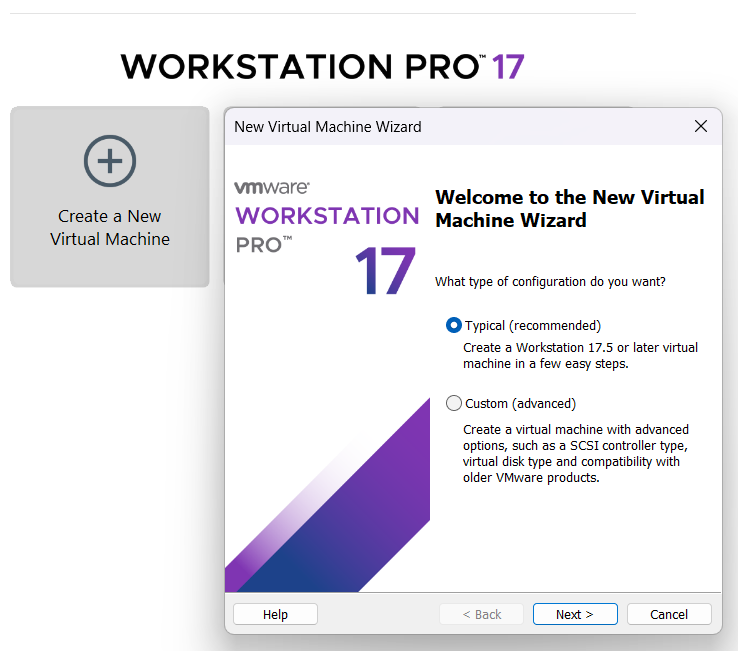

3. Installing by selecting ISO image as disk:

    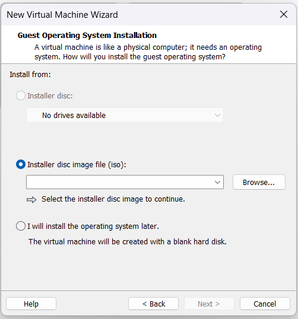

4. Provide a name and a path for VM location:

    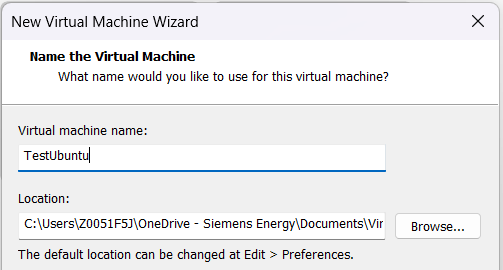

5. Set size disk and storing mechanism:

    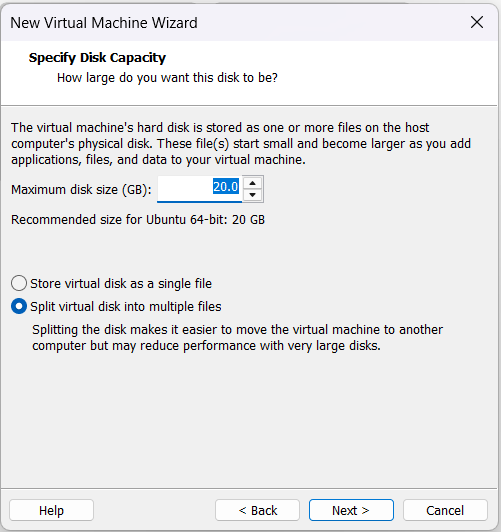

6. Other relevant features: RAM 4096, CPU: 2, NetAdapter: NAT

    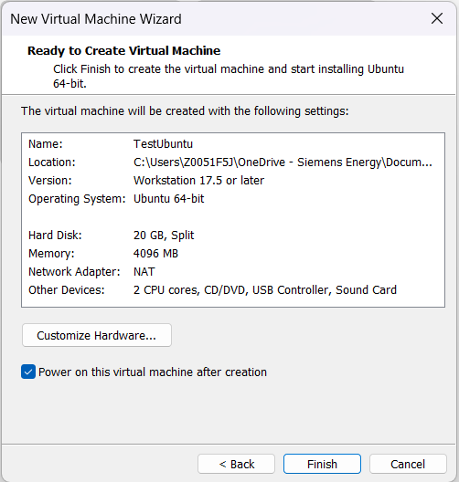

7. Select installation method:

    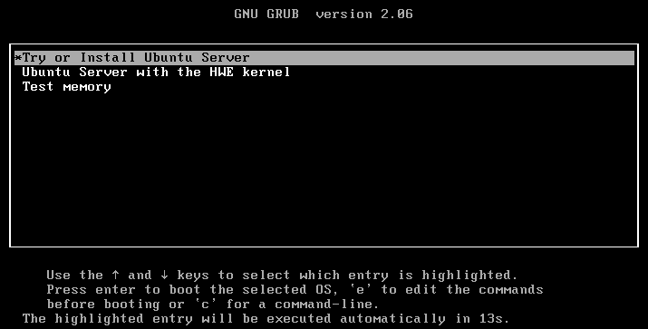

8. Select prefered languaje:

    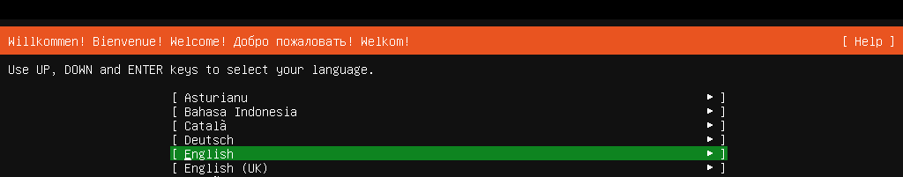

9. Continue without update:

    

10. Select keyboard:

    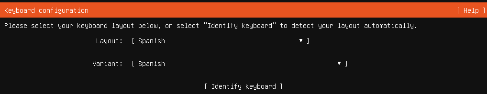

11. Select Installation base:

    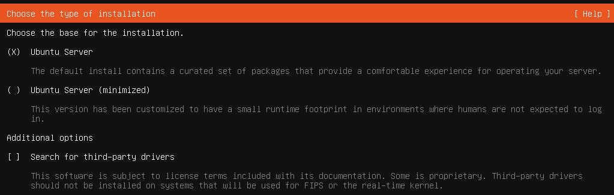

12. If VM is network connected DHCP brings:

    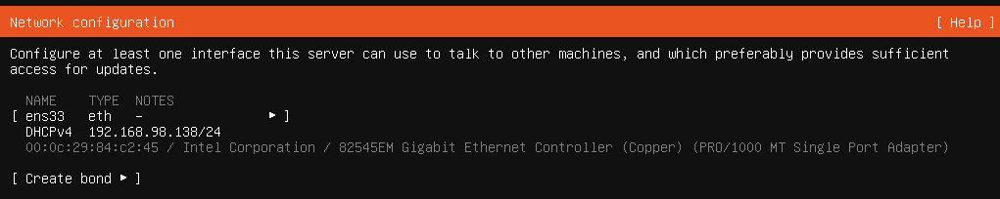

13. Select entire disk:

    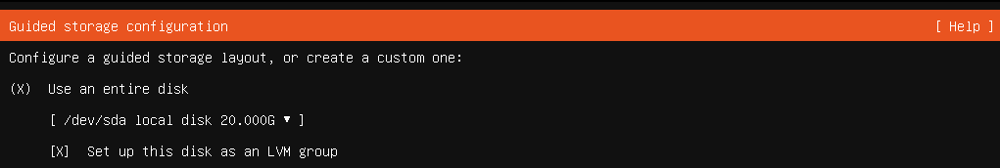

14. It is recommended to use the entire partion:

    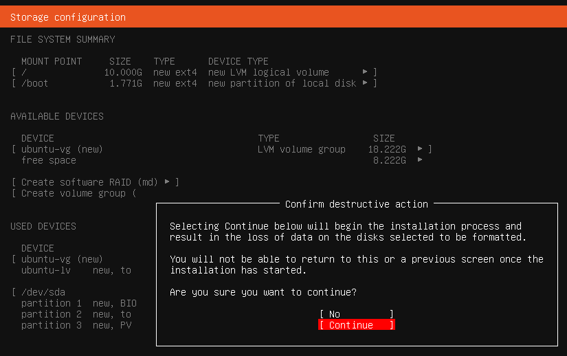

15. Add *Name*, *Lastname*, *username* and *password*.

16. Install openssh during normal installation:

     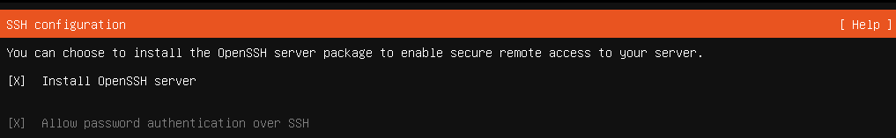 

17. Not select other feature.

18. Wait for final installation steps.

19. Select reboot after installation is finalized.

    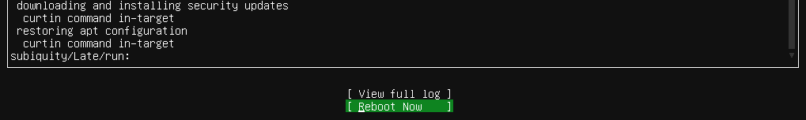

20. Log in the created VM.

## VSCode integration

21. Obtain the ip address of the remote VM:

    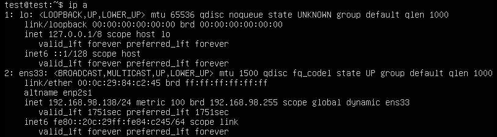

22. Connect to a host by using the remote ssh extension:

    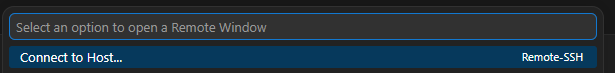

23. Add a new host: `ssh test@<ip address>`
24. Select the path of the ssh config: `C:\Users\<User>\.ssh\config`
25. Connect to a host and select that platform of that host:

    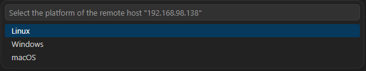

26. VSCode is connected to the created VM:

    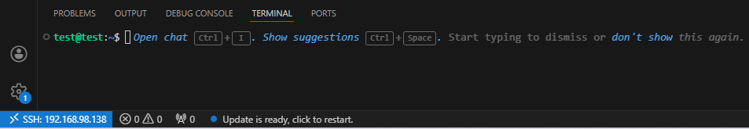

## Docker installation

27. Install docker:

    ```bash
    sudo apt update
    sudo apt install docker.io
    sudo apt install docker-compose
    ```

28. Check docker version:

    ```bash
    $ docker version
    Client:
     Version:           29.1.3
     API version:       1.52
     Go version:        go1.24.4
     Git commit:        29.1.3-0ubuntu3~22.04.2
     Built:             Wed Apr 29 22:18:59 2026
     OS/Arch:           linux/amd64
     Context:           default
    ```

29. Check docker-compose version:

    ```bash
    $ docker-compose version
    docker-compose version 1.29.2, build unknown
    docker-py version: 5.0.3
    CPython version: 3.10.12
    OpenSSL version: OpenSSL 3.0.2 15 Mar 2022
    ```

30. Create the docker group:

    ```bash
    $ sudo groupadd docker
    ```

31. Add your user to the docker group.

    ```bash
    $ sudo usermod -aG docker $USER
    ```

32. Activate the changes to groups

    ```bash
    $ newgrp docker
    ```

33. Test docker changes:

    ```bash
    $ docker run hello-world
    Unable to find image 'hello-world:latest' locally
    latest: Pulling from library/hello-world
    4f55086f7dd0: Pull complete 
    d5e71e642bf5: Download complete 
    Digest: sha256:c567b231f65614688711a75f31518a064258a51d442117a3e771a3a8fdba78ef
    Status: Downloaded newer image for hello-world:latest

    Hello from Docker!
    This message shows that your installation appears to be working correctly.

    To generate this message, Docker took the following steps:
     1. The Docker client contacted the Docker daemon.
     2. The Docker daemon pulled the "hello-world" image from the Docker Hub.
        (amd64)
     3. The Docker daemon created a new container from that image which runs the
        executable that produces the output you are currently reading.
     4. The Docker daemon streamed that output to the Docker client, which sent it
        to your terminal.

    To try something more ambitious, you can run an Ubuntu container with:
     $ docker run -it ubuntu bash

    Share images, automate workflows, and more with a free Docker ID:
     https://hub.docker.com/

    For more examples and ideas, visit:
     https://docs.docker.com/get-started/
    ```
